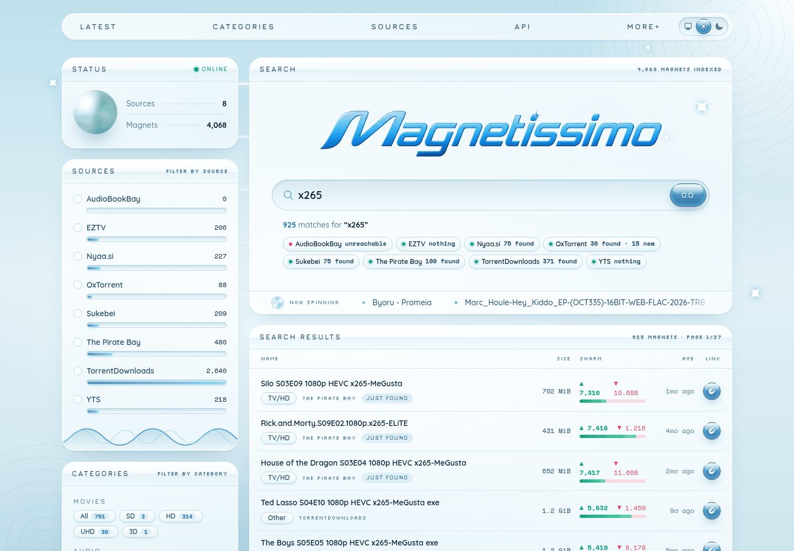

<h1 align="center">Magnetissimo</h1>

<p align="center">
  A self-hosted torrent indexer. Search once, ask eight torrent sites at the
  same time, and keep every magnet link they hand back.
</p>

<p align="center">
  
</p>

## What it does

You type a term. Magnetissimo answers from its own index straight away, and
at the same moment asks every source's own search for that term. Each site's
answer is indexed as it lands, and the new rows slide into the page while
you watch. The next person to search for the same thing gets it from the
index.

Sites are asked when someone searches, so the index grows into a record of
what you looked for.

- **Eight sources:** YTS, Nyaa.si, Sukebei, TorrentDownloads, AudioBookBay,
  The Pirate Bay, EZTV and OxTorrent.
- **The BitTorrent DHT, if you want it.** Turn on the DHT crawler and
  Magnetissimo finds torrents on its own, all the time, straight from the
  peer-to-peer network, file lists included. Watch them arrive on `/dht`. See
  [The DHT crawler](#the-dht-crawler).
- **Torznab categories.** Every torrent is filed under the standard
  Newznab/Torznab category list that Sonarr, Radarr, Prowlarr and Jackett
  use, whatever the source called it.
- **Search that looks inside torrents.** Names, descriptions, and the file
  names of torrents the DHT found.
- **Search that copes with real names.** `spider-man` finds
  `Spider.Man.2002`, `toy story 4` matches the `4`, and a fragment of a
  Japanese title matches without any spaces to split on. Better-seeded
  copies rank first among near-identical names.
- **Search operators** that no source has: exact text, exclusions,
  alternatives and wildcards, plus size, seeder and age limits. See
  [Searching](#searching).
- **Works without JavaScript.** Searching, filtering, sorting and paging are
  all links and plain GET forms. With JavaScript on, results stream in live.
- **A Torznab indexer** for Sonarr, Radarr, Lidarr, Prowlarr and the book
  managers, and **a JSON API** for scripts.
- **One SQLite database.** To back it up, stop the app and copy the data
  folder.

## Running it

### With Docker

This is the easiest way, and works on anything that runs Docker: a
homelab server, a NAS, or a Raspberry Pi (the image is built for amd64 and
arm64). Save this as `compose.yaml`:

```yaml
services:
  magnetissimo:
    image: ghcr.io/sergiotapia/magnetissimo:latest
    container_name: magnetissimo
    restart: unless-stopped
    ports:
      - "4000:4000"
    volumes:
      - magnetissimo-data:/data

volumes:
  magnetissimo-data:
```

Then start it:

```bash
docker compose up -d
```

Open `http://<your server>:4000`. That's the whole setup. The database and
a generated secret key are kept in the `magnetissimo-data` volume, and every
start runs any pending migrations. To upgrade, run
`docker compose pull && docker compose up -d`.

To keep the data in a folder instead of a volume, mount the folder at
`/data` and run the container as the folder's owner:

```yaml
    user: "1000:1000"
    volumes:
      - ./data:/data
```

If you've cloned the repository, the `compose.yaml` there builds the image
from source, so `docker compose up -d` works straight from the checkout. To upgrade a checkout, run
`git pull && docker compose up -d --build`.

`:latest` is the newest release. `:edge` follows every commit to `master`,
and `:3`, `:3.0` or `:3.0.0` pin a version.

### As an Elixir release

A [release](https://mix.hexdocs.pm/Mix.Tasks.Release.html) is a
self-contained directory with the Erlang runtime included. Build it on the
same OS and CPU architecture as the server it will run on:

```bash
mise install                     # Elixir 1.20.4 / OTP 29.1.1
MIX_ENV=prod mix deps.get --only prod
MIX_ENV=prod mix assets.setup
MIX_ENV=prod mix assets.deploy
MIX_ENV=prod mix release
```

Copy `_build/prod/rel/magnetissimo` to the server and start it:

```bash
mkdir -p /var/lib/magnetissimo
DATABASE_PATH=/var/lib/magnetissimo/magnetissimo.db bin/server
```

`bin/server` runs it in the foreground, which is what a systemd unit or a
process supervisor wants. To run it in the background, start it as a daemon
with `PHX_SERVER=true`:

```bash
PHX_SERVER=true DATABASE_PATH=... bin/magnetissimo daemon
bin/magnetissimo remote    # a console inside the running app
bin/magnetissimo stop
```

Starting the app runs any pending migrations. `bin/migrate` runs them on
their own.

### Configuration

Only `DATABASE_PATH` is required, and the Docker image already sets it.

| Variable | Default | What it does |
| --- | --- | --- |
| `DATABASE_PATH` | `/data/magnetissimo.db` in Docker | The SQLite file. Its directory must exist and be writable. |
| `PORT` | `4000` | The HTTP port. |
| `SECRET_KEY_BASE` | generated | Signs cookies. When unset, a random one is generated on first start and saved as `secret_key_base` next to the database. |
| `PHX_HOST` | none | Your public hostname, if the app is behind an HTTPS reverse proxy. Leave it unset for plain `http://<ip>:4000`. |
| `POOL_SIZE` | `5` | Database connections. |
| `DHT_PORT` | any free port | The local UDP port the [DHT crawler](#the-dht-crawler) sends from. Nothing needs forwarding. |

Magnetissimo speaks plain HTTP. To serve it over HTTPS, put it behind a
reverse proxy such as Caddy, Traefik or nginx, and forward WebSockets, which
is what makes results stream in. The app answers on any host name or IP it is
reached at, and the live-update socket accepts pages served from that same
host.

### For development

```bash
git clone https://github.com/sergiotapia/magnetissimo
cd magnetissimo
mise install
mix setup          # dependencies, database, sources, assets
mix phx.server
```

Then open [localhost:4000](http://localhost:4000). In development the
database starts with a few dozen demo torrents to look at.
Search for something and the real sources start filling the index.

## Searching

The search box takes plain words, as any search does, and these:

| Type | Finds |
| --- | --- |
| `dune part two` | All three words, anywhere in the name or description. |
| `"[ToonsHub]"` | Exactly what is between the quotes, brackets and spaces included, ignoring case and accents. `"part two"` does not find `Dune.Part.Two`: leave the quotes off for that. |
| `dune -cam` | Dune, without the whole word `cam`. `El Camino` and `HDCAM` stay. |
| `dune -*cam` | Dune, without `cam` anywhere in a word, so `HDCAM` goes too. |
| `dune 2160p\|4k` | Dune in either resolution. A bar binds tighter than a space. |
| `seinfeld s05e1*` | Any word starting with `s05e1`. A star in the middle, `s0*e14`, matches anything between. |

Under the search box, **Refine** limits the results to names only, a size
(`2 GB`, `700 MB`; binary units, as the sites use, and a bare number is GB),
a number of seeders, or an age (`12h`, `7d`, `2w`, `3mo`, `1y`; a bare number
is days). These filters also apply to the latest list when the search box is
empty.

The sites themselves only understand plain words, so they are never sent the
operators. They are asked the words you typed, without exclusions or
wildcards, and once for each alternative (`dune 2160p` and `dune 4k`), up to
three searches. Magnetissimo applies everything else to what they return.
Changing a filter or an exclusion asks no site again.

Torznab apps and the JSON API search plain text: there, `-` and `"` are
just part of a title.

## The DHT crawler

Every BitTorrent client is part of the DHT, the peer-to-peer network that
makes magnet links work. Open **`/dht`** (the **DHT** link in the header),
flip the switch, and Magnetissimo walks it in the background: it asks peers for samples of the torrents they know, fetches
each torrent's name and file list from the peers sharing it, files it under
a category, and estimates its seeders and leechers.

- The same page shows what it finds as it arrives: the latest hundred,
  with live seeder counts, and how hard the crawler is working. The switch
  and the rate are saved in the database and apply at once. It starts off.
- Searches find DHT torrents like any other, including by the names of the
  files inside them. They stay out of "Fresh magnets", the Torznab RSS poll
  and `/api/latest`, which they would flood.
- Nothing needs forwarding. The crawler is a read-only DHT node, so it works
  behind NAT and in Docker as is.

**Your router.** A crawler talks to thousands of different addresses, and
a home router keeps a table entry for each. Fill that table and everyone's
browsing stalls, whatever the bandwidth. The rate slider on `/dht` sets
how hard the crawler works. Each stop was measured on a home connection:

| Rate | Router table entries it adds | Bandwidth out / in | Torrents found |
| --- | --- | --- | --- |
| `gentle` (default) | about 600, at most ~900 | 10 / 25 kbit/s | ~900 an hour |
| `normal` | about 2,000, at most ~3,000 | 35 / 85 kbit/s | ~2,600 an hour |
| `max` | about 6,500, at most ~9,000 | 110 / 260 kbit/s | ~7,000 an hour |

`gentle` is safe on any router, and `normal` on most. `max` fills the
4,000-entry table of a cheap router, so keep it for a VPS, a VPN container
or a router with room for 16,000 connections or more. If browsing slows
down, slide it down or route the container through a VPN. [`docs/dht.md`](docs/dht.md) has the details and
the measurements.

**Privacy.** Fetching a torrent's file list is a real BitTorrent
connection, so the peers in a swarm, and anyone watching it, see your IP.
No content is downloaded. Use a VPN if that matters to you. The DHT holds
everything people share. Adult torrents are filed under XXX, and a list of
banned keywords keeps abuse material out of the index.

## Sonarr, Radarr and the book managers

Magnetissimo is a Torznab indexer at `/api`. In each app, add an indexer of
type **Torznab** (in Prowlarr, **Generic Torznab**, which then syncs it to
every app it manages) with:

- **URL:** `http://<ip>:4000`, the address the app reaches Magnetissimo on.
- **API path:** `/api`, the default.
- **API key:** anything, or blank. There is no key to check. Listenarr won't
  save a blank one, so type any word.
- **Categories:** the defaults work. Asking for a subcategory includes
  torrents a site only filed under its parent, so Sonarr's default TV/SD and
  TV/HD also get everything EZTV files under TV.

| App | Searches with | Categories to pick |
| --- | --- | --- |
| Sonarr | Title and `S01E02`, `S01`, or an air date | TV/SD, TV/HD; anime under TV/Anime |
| Radarr | Title and year | Movies and its subcategories |
| Lidarr | Artist and album | Audio |
| Chaptarr, Bookshelf, Readarr | Author and title | Audio/Audiobook, Books/EBook |
| Listenarr | Title, author and series | `3030` (Audio/Audiobook) |
| LazyLibrarian | Author and title | found by name |

What to expect:

- **A search takes 5 to 20 seconds.** Every site is asked live, as in the
  web UI. The apps allow far longer.
- **Searches are by text, not by IMDb or TVDB id.** The sites only search
  by text, so Magnetissimo tells the apps it takes text, and they send the
  title.
- **RSS syncs and the Test button never reach the sites.** They are
  answered from the index, newest first. On a fresh install with nothing in
  the chosen categories, Test sees one placeholder item that cannot be
  grabbed, rather than failing.
- **Big backfills go slowly on purpose.** Each site gets at most two
  searches at a time, a second apart, however many apps are asking. A
  "search all missing" over a large library takes a while, and no site gets
  hammered.

## JSON API

| Endpoint | Returns |
| --- | --- |
| `GET /api/latest` | The 50 most recently published torrents in the index. |
| `GET /api/search/:term` | The best 50 matches for `term`. |

A search gives the sources up to twenty seconds to answer before it reads
the index. A term that was searched in the last fifteen minutes is answered
straight from the index. Both endpoints return `{"data": [...]}`, where each
torrent looks like this:

```json
{
  "id": 11673,
  "name": "Dune Part Two (2024) [1080p] [WEBRip] 88",
  "description": null,
  "canonical_url": "https://thepiratebay.org/description.php?id=75005578",
  "published_at": "2024-04-06T04:39:43.000000Z",
  "seeders": 924,
  "leechers": 147,
  "size_in_bytes": 2968337547,
  "magnet_hash": "2770fe270845674966e184be60ed1be0fe494f3a",
  "magnet_url": "magnet:?xt=urn:btih:2770fe270845674966e184be60ed1be0fe494f3a&dn=Dune+Part+Two…&tr=…",
  "category": "Movies/HD",
  "category_id": 2040,
  "source": "The Pirate Bay"
}
```

`category` is the Torznab category name and `category_id` its number.

## How it is built

Phoenix 1.8 and LiveView 1.2 on Bandit, with Ecto on SQLite. Search runs
on two FTS5 indexes: one on trigrams for substrings in any script, and one on
whole words for short tokens like the `4` in `toy story 4`. All HTTP goes through
[Req](https://hexdocs.pm/req). The DHT crawler is plain OTP: `:gen_udp`,
`:gen_tcp` and its own bencode, with no dependency. The interface is hand-written Tailwind. Its
look, a corporate Y2K glass atrium, is described in
[`docs/design.md`](docs/design.md).

## Contributing

Read [CONTRIBUTING.md](CONTRIBUTING.md). It covers setup, the checks every
commit has to pass, how to add a new source, and the design decisions behind
the code.
